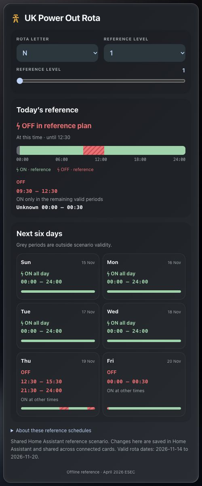

# UK Power Out — Reference Sensors

Offline Home Assistant custom integration for **hypothetical April 2026 ESEC Annex 2 Variable Rota scenarios**. Configuration UI, persistent shared settings, scheduled reference supply/restriction status, and next restriction/restoration timestamps. No runtime downloads or third-party Python requirements.

The companion dashboard card can display and edit the same scenario:



**This does not confirm actual power cuts, NESO activation, an Indicative/Implementation Rota Plan or an Activation Schedule.** Selecting a level does not activate restrictions. Scheduled ON does not guarantee electricity supply. Official instructions, protected-site rules and local network conditions take precedence.

## Install and configure

Requires Home Assistant **2026.11.0** or newer.

Add `https://github.com/sarn-online/uk-power-out` as a Marketplace custom repository, category **Integration**, then install it. HACS uses the same repository format. Follow any restart prompt. Custom-repository installation is separate from inclusion in the default catalog.

[Open this integration repository in Home Assistant](https://my.home-assistant.io/redirect/marketplace_repository/?owner=sarn-online&repository=uk-power-out&category=integration)

For manual installation, copy `custom_components/power_out/` into `<config>/custom_components/`, then restart Home Assistant. Add Power Out under Settings → Devices & services → Add integration. Home Assistant may route this helper integration through Helpers; confirm the setup prompt.

Choose your operator-confirmed load block, reference level 1–18, plan type and first/last rota dates. Valid letters are **A B C D E G H J K L M N P Q R S T U**. A level is a hypothetical scenario, not an account number or a live grid reading. [Power Cut 105](https://www.powercut105.com/) can identify your network operator, who can confirm your load block.

Settings persist in Home Assistant and are shared across devices. To edit them, open Settings → Devices & services → Helpers → Power Out reference supply → Settings → Power Out options. Multiple independent reference scenarios are allowed; choose the correct entity when linking a card.

## Plan and date semantics

Only **Variable Rota — Annex 2 reference** is calculated. ESEC section 6.3 Low-Level plans depend on event instructions and the block last disconnected in the previous event. They cannot be derived from these tables or calendar dates. Actual activation schedules are not inferred.

The first rota date starts at **00:30 Europe/London**. The inclusive final rota date ends at **00:30 the following day**. A maximum of 367 rota dates is allowed. For example, rota dates 14–20 November are valid from 00:30 on 14 November until 00:30 on 21 November; the first half-hour on 14 November is outside that scenario. No automatic extension occurs after expiry.

Weekly columns use the actual UK weekday, even when a scenario begins midweek. Eight nominal three-hour periods begin at 00:30, 03:30, 06:30, 09:30, 12:30, 15:30, 18:30 and 21:30. Clock changes make the first period two or four elapsed hours. The server's timezone does not change calculations. Consecutive OFF slots merge across midnight and week boundaries.

## Entities

| Entity | Meaning |
| --- | --- |
| Reference supply sensor | Scheduled ON or Scheduled OFF; unknown outside validity |
| Reference restriction binary sensor | ON = reference restriction / scheduled supply OFF; OFF = no reference restriction; unknown outside validity |
| Next reference restriction | Next strictly future OFF transition within the dated scenario |
| Next reference restoration | End of the current or next OFF interval, only when a following ON period is established within validity |

A missing future event is unknown. End of validity is not evidence of restoration: level 18 stays OFF continuously within the scenario and has no predicted restoration. Entity attributes include reference-only status, rota, level, plan, dates, UTC validity boundaries and UK timezone. No actual supply state is measured.

Entities update at exact transitions. Scenario edits refresh existing entities and timers in place; they do not unload/reload platforms. Settings survive restarts. Updates/removal of already-loaded integration code may require a restart; follow Home Assistant's prompt.

## Companion card and action

Install [UK Power Out Rota](https://github.com/sarn-online/uk-power-out-card), then set its `entity` option to your actual reference supply sensor:

```yaml
type: custom:power-out-card
title: UK Power Out Rota
entity: sensor.power_out_reference_supply
```

Entity IDs may have suffixes. Dropdowns and the slider preview instantly and save centrally. The action can also be called from automations:

```yaml
action: power_out.set_scenario
data:
  entity_id: sensor.power_out_reference_supply
  level: 5
```

Provide `rota`, `level`, or both. Only those fields change; dates and plan type are preserved. The action validates the entity, rota and integer level, and checks the caller's entity-control permission. It changes a reference scenario, never physical electricity supply or an actual restriction declaration.

## Validation and development

Standard-library checks:

```sh
python3 -m unittest discover -s tests -v
python3 scripts/validate_package.py
```

Tests cover all 324 combinations and 3,265,920 civil minutes, explicit validity, transitions, year boundaries, clock changes, invalid inputs and six PDF/workbook discrepancy fixtures. [Source provenance](SOURCE_VALIDATION.md) includes checksums and discrepancy coordinates.

A direct Home Assistant 2026.11.0 runtime smoke test exercises config flow, all four entities, central actions, permissions, in-place updates without removal/unavailable events, options changes, disk persistence and unload/reuse:

```sh
pip install homeassistant==2026.11.0
python scripts/smoke_homeassistant.py
```

Additional fixture tests use `pytest-homeassistant-custom-component==0.13.375` (HA 2026.10.4) in a separate environment: `python -m pytest tests/ha -v`. CI keeps that environment separate from the 2026.11.0 smoke test and runs hassfest and official HACS validation. A local test result does not establish that remote checks passed.

For removal, delete the helper/config entry through Home Assistant before uninstalling its repository. References in dashboards or automations must be removed or changed separately.

## Source and licence

DESNZ, *Electricity Supply Emergency Code*, revised April 2026, sections 6–7 and Annexes 1–2. [Official publication](https://www.gov.uk/government/publications/electricity-supply-emergency-code). The bundled 18 × 18 × 56 Boolean table follows the supplied PDF, including six cells where it differs from the accessible workbook; it is not extrapolated from a formula. Source data is public sector information under the [Open Government Licence v3.0](https://www.nationalarchives.gov.uk/doc/open-government-licence/version/3/). Code: MIT; see [LICENSE](LICENSE). Independent project; no government, NESO or Home Assistant affiliation.
